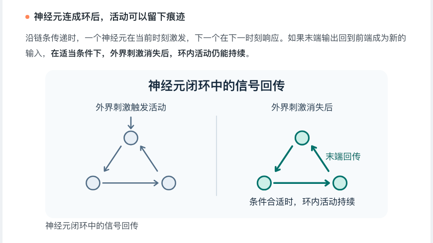

# Video Report Agent · Public Core

[简体中文](README.md) | English

Turn video transcripts into HTML reports you can skim, read in depth, and save.

## See the result

<a href="docs/examples/report.png"></a>

[Sample HTML](docs/examples/report.html) · [Full PNG](docs/examples/report.png)

Download the sample HTML from GitHub and open it in your browser. Standard reports follow your system theme, and you can switch between light and dark in the report.

## Choose how to use it

| What you want to do | Start here |
|---|---|
| Generate a report online | [Open VReport](https://vreport.tri4t.xyz) |
| Turn an existing transcript, subtitles, or long text into a report | [Download Skill ZIP v0.7.0](https://github.com/imexlovery/video-report-agent/releases/download/skill-zip-v0.7.0/video-report-skill-v0.7.0.zip) for your own coding agent |
| Transcribe or generate a report locally from a single Bilibili, YouTube, Douyin, or Xiaohongshu video link | [Use the full CLI](#option-2-run-the-complete-cli-pipeline) |

## Option 1: use your own Coding Agent

You’ll need a coding agent with a configured model and access to read and write local files.

1. <a name="2-get-the-complete-skill-directory"></a>Download and unzip the Skill ZIP above. Keep the entire `video-report/` directory together.
2. <a name="1-prepare-a-complete-transcript"></a><a name="3-ask-the-agent-to-generate"></a>Open your coding agent in the extracted directory and try the bundled transcript with this prompt:

   ```text
   Read video-report/SKILL.md and use standard mode.
   Read all of examples/transcript.md and treat it as read-only input.
   Preserve important conditions, numbers, and attributions.
   Write a self-contained HTML report to output/report.html.
   ```

3. Open `output/report.html` in your browser.

<a name="how-the-template-skill-works"></a>The [report Skill](src/video_report_agent/skills/video-report/SKILL.md) provides separate reading rules and templates for Standard and Brief. Replace the example path with your own transcript to run it on new material. Use `brief` in place of `standard` for a shorter read focused on the main findings and evidence. See the [Skill ZIP guide (Chinese)](docs/skill-bundle/README.md).

## Option 2: run the complete CLI pipeline

<a name="install"></a>You'll need Python 3.12, uv, FFmpeg, and Node.js 22.19.0 or later. Follow the guide to [install the CLI and its dependencies](docs/cli.en.md#install), then <a name="configure-the-model-and-asr"></a>[configure the report model and transcription](docs/cli.en.md#configure-the-model-and-asr).

<a name="generate-and-read"></a>From the repository directory, run this command with your video link:

```sh
uv run video-report generate 'https://www.bilibili.com/video/BV...'
```

Open `runs/<run-id>/report.html` when the run finishes. If you only need a transcript, use [`transcribe`](docs/cli.en.md#generate-and-read).

## Development and further reading

- [CLI guide](docs/cli.en.md) · <a name="choose-subtitle-and-transcript-sources"></a>[Subtitle and transcript sources](docs/cli.en.md#choose-subtitle-and-transcript-sources) · <a name="unified-source-access"></a>[Link checks and local acquisition](docs/cli.en.md#unified-source-access) · <a name="douyin-and-xiaohongshu-acquisition"></a>[Douyin and Xiaohongshu acquisition](docs/cli.en.md#douyin-and-xiaohongshu-acquisition)
- <a name="optional-tools-and-capabilities"></a>[Optional tools and flags](docs/cli.en.md#optional-tools-and-capabilities) · <a name="configure-search-for-term-correction"></a>[Search for term correction](docs/cli.en.md#configure-search-for-term-correction) · <a name="runtime-and-data"></a>[Runtime and data](docs/cli.en.md#runtime-and-data)
- [Core documentation (Chinese)](docs/README.md) · [Report evaluation](evals/report-review/README.md)

Public Core maintains the generation pipeline and report Skill. A separate web service runs the website and manages accounts and credits.
