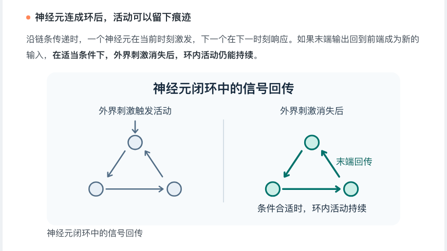
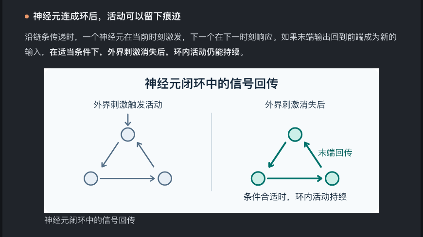

# Video Report Agent · 公开核心

简体中文 | [English](README.en.md)

把视频转写整理成可以扫读、精读和保存的 HTML 阅读报告。

## 先看成品

《沃尔特·皮茨：用逻辑解释大脑，怎样启发了计算机》是一份由 GPT-6.2 Sol 生成的 Standard 报告。它用点奶茶解释「与」「或」和「抑制」，再用独立图示说明神经元闭环中的信号回传。

| 浅色 | 深色 |
| :---: | :---: |
| [](docs/examples/report.png) | [](docs/examples/report-dark.png) |

[完整 HTML 报告](docs/examples/report.html) · [浅色长图](docs/examples/report.png) · [深色长图](docs/examples/report-dark.png)

从 GitHub 下载 HTML，用浏览器打开。报告默认跟随系统配色，也可以用右上角按钮切换。

## 选择使用方式

| 你想怎么用 | 从这里开始 |
|---|---|
| 想在线生成报告 | [打开 VReport](https://vreport.tri4t.xyz) |
| 已有转写、字幕或长篇文本 | [下载 Skill ZIP v0.7.0](https://github.com/imexlovery/video-report-agent/releases/download/skill-zip-v0.7.0/video-report-skill-v0.7.0.zip)，交给自己的 AI Agent |
| 有 B 站、YouTube、抖音或小红书的单视频链接，想在本地运行 | [使用完整 CLI](#方式二运行完整-cli-流水线)，生成转写或报告 |

<a name="方式一交给自己的-coding-agent"></a>

## 方式一：交给自己的 AI Agent

用一个已配置模型、能读写本地文件的 AI Agent 即可试用。

1. <a name="2-获取完整-skill-目录"></a>下载并解压上面的 Skill ZIP，保留完整的 `video-report/` 目录。
2. <a name="1-准备完整转写"></a><a name="3-发送生成指令"></a>在解压目录打开 AI Agent，用包里的示例转写试跑。发送下面这段指令：

   ```text
   读取 video-report/SKILL.md，使用 standard 模式。
   完整阅读 examples/transcript.md，将示例转写作为只读输入。
   保留重要条件、数字和归属，生成自包含 HTML，写入 output/report.html。
   ```

3. 用浏览器打开 `output/report.html`。

<a name="模板-skill-如何工作"></a>[报告 Skill](src/video_report_agent/skills/video-report/SKILL.md) 为 Standard 和 Brief 提供各自的阅读规则与模板。换成自己的转写时，替换输入路径即可。想先看主要结论和依据，可把 `standard` 改成 `brief`。详见 [Skill ZIP 使用说明](docs/skill-bundle/README.md)。

<a name="报告流程中可选的工具与能力"></a>

## 报告生成工具

完整 Core 流水线提供下列工具。独立 Skill ZIP 使用你自己的 AI Agent 提供的工具。

| 工具与开关 | 能做什么 |
|---|---|
| **独立绘图** | Standard 中由 AI Agent 按需发起，把机制、步骤或关系画成 SVG 并嵌入正文。 |
| **术语求证** `--term-correction` | 先用视频信息核对人名、产品名和专业术语，证据不足时查找网页来源，保留原始转写。 |
| **画面辅助** `--visual-enhancement` | 从 B 站视频抽取 9 帧，用支持图片输入的模型生成画面描述，补充字幕里的演示信息。 |
| **报告检查** `--report-inspection` | 把初稿的结构检查、来源定位和可用截图反馈给同一个 AI Agent，供它集中修订。 |
| **文风校订** | 单独整理句子和段落衔接，减少生硬转述。默认开启，可用 `--no-style-edit` 关闭。 |

只想准备素材时，可以用 `preflight` 检查链接，或用 `fetch-source` 获取可用字幕，缺少字幕时提取音频。各工具的默认值、限制和 Python 参数见 [CLI 使用指南](docs/cli.md#报告流程中可选的工具与能力)。

## 方式二：运行完整 CLI 流水线

<a name="安装"></a>准备 Python 3.12、uv、FFmpeg 和 Node.js 22.19.0 或更新版本，按指南[安装 CLI 和运行依赖](docs/cli.md#安装)，再<a name="配置模型与转写"></a>[配置报告模型和转写](docs/cli.md#配置模型与转写)。

<a name="生成与查看"></a>在仓库目录运行下面的命令，把示例地址换成你的视频链接：

```sh
uv run video-report generate 'https://www.bilibili.com/video/BV...'
```

完成后打开 `runs/<run-id>/report.html`。只需要文字稿时，使用 [`transcribe`](docs/cli.md#生成与查看)。

## 开发与进一步阅读

- [CLI 使用指南](docs/cli.md) · <a name="选择字幕与转写来源"></a>[字幕与转写来源](docs/cli.md#选择字幕与转写来源) · <a name="统一链接检查与用户电脑取材"></a>[链接检查和本机取材](docs/cli.md#统一链接检查与用户电脑取材) · <a name="抖音与小红书取材"></a>[抖音与小红书取材](docs/cli.md#抖音与小红书取材)
- <a name="术语纠错的搜索服务配置"></a>[术语搜索配置](docs/cli.md#术语纠错的搜索服务配置) · <a name="运行与数据约定"></a>[运行与数据](docs/cli.md#运行与数据约定)
- [Core 项目文档](docs/README.md) · [报告评测](evals/report-review/README.md)

公开 Core 维护生成流水线和报告 Skill，网站、账户与额度由独立的 Web Service 维护。
