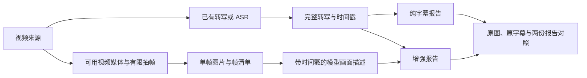

# 稀疏画面辅助理解方案

状态：独立完整报告对照已完成，2026-10-28。当前按“关键帧生成带时间戳的画面描述，与原字幕并行保留”验证；正式流水线接入、会员权益和发布仍未实施。

实验入口为 [`evals/sparse-visual/`](../evals/sparse-visual/README.md)。使用 baseline 的 optics，固定原字幕、模型、思考档位、模式、Skill、模板与初始提示，分别生成纯字幕和“字幕＋画面描述”的完整报告。原图和描述独立保留，不修改原字幕、产品 Skill 或正式流水线。下文的更多帧数、直接图文和正式接入均为后续候选。

optics 增强报告已实际引用画面描述，补充页面标记并支持转写校对，但出现一处方向转述错误，部分段落重复已有口述；当前增益有限，继续保留为实验。完整报告、逐项比较、失败恢复记录和分阶段用量在忽略的 `.local/evals/optics-visual-20261028/comparison.md`。此前 CRM 仅描述实验保留在 `.local/evals/sparse-visual-20261028/ruwei-crm/`，首轮完整对照以 optics 为准。

随后保持 9 帧与同一描述策略，补测了更依赖操作画面的 cooking baseline。增强报告引用 6 帧，补充外观与操作姿势，但核心刀路和关键状态时点仍覆盖不足；完整处理累计约多 79 秒、tokens 多 3.42%，两组都无失败。该样本的完整报告、逐帧判断与分阶段数据在 `.local/evals/cooking-visual-20261028/comparison.md`，仍未接入正式流水线。

## 1. 目标与取舍

在完整转写之外提供少量带时间戳的画面描述，检查完整报告能否补足未被口述的信息，并区分转写纠错、重复内容与视觉误读。视频截图展示留待后续验证。

| 事项 | 合并后的方案 | 状态与原因 |
|---|---|---|
| 稀疏抽帧 | 以 9 帧为实验起点，保留 30/60 帧对照的可能 | 用户可接受的起点；不是所有时长的产品默认值 |
| 时间轴 | 转写区间与帧时间点关联，原始材料分别保留 | 用户提出的方向；避免把单帧当作整个区间的事实 |
| 模型输入 | 本轮先用原始帧与附近字幕生成独立画面描述 | 用户指定的实验路线；尚无两条路线的同输入质量对照 |
| 处理分路 | 抽帧独立于 ASR，复用同一视频身份与时间基准 | 独立产物不要求新增 Agent 或并发调度 |
| 报告展示 | 首轮不默认插入视频截图，继续使用已有模板 | 尊重用户当前倾向；最终展示方式仍待阅读实验 |
| 会员功能 | 先测质量、成本和耗时，接入时保留调用方控制开关 | 高级功能是候选定位，权益与收费尚未确定 |

首版不做逐帧视觉推理、由大模型挑选全片关键帧、视频动作理解保证、视觉向量库、多 Agent 编排或自动对外发布。本轮脚本独立运行；正式接入时仍沿用 Core 的 Python → Pi RPC → 单 Agent → HTML 主链。

## 2. 参考项目与当前基础

- [Bili Whale](https://github.com/Alterssss/dsh-bili-whale/blob/9ba49bec1a0f6923dcb95f28e2df05d7abcbaeb3/tools/commands/bili-watch.mjs)默认 3×3：等间隔时间点提供全片分布，再向附近的场景变化点移动，最后拼图。可借鉴固定预算和覆盖方式；首版不照搬其多阈值重复扫描，也不把九宫格作为读取小字的唯一输入。
- [DOVideo-AI](https://github.com/Xiaoc7r/DOVideo-AI/blob/df4fa83a78a51dfa1718606bf47cf49942e1112e/server/src/main/java/com/example/server/service/VideoContextService.java)的帧处理使用首帧、场景分数大于 0.35、距上次选帧达到 30 秒的候选，再以 dHash 去重并执行 OCR。可借鉴时间对齐与候选去重；其阈值不是本项目的已验证参数，其 OCR 分支也不是视觉模型效果证明。
- Core 已有带来源 ID 和起止时间的规范转写，模型读取 `transcript.md`。现有 OCR 主要用于字幕文字融合；一般 OCR 也能读 PPT 或界面文字，但不能仅靠文字识别结果解释图形关系和操作变化。
- 当前下载缓存区分音频与视频；纯 ASR 路径可能只保留音频。完整转写命中缓存时还可能跳过媒体获取，不能假定每份历史报告都有可抽帧的视频。
- 当前报告由 Pi/Skill 生成 HTML，Python 负责后处理与 PNG。视觉接入不另建一套控制正文布局的渲染器。

源码入口：[pipeline.py](../src/video_report_agent/pipeline.py)、[reuse.py](../src/video_report_agent/reuse.py)、[transcript_foundation.py](../src/video_report_agent/transcript_foundation.py)、[pi.py](../src/video_report_agent/pi.py)。

## 3. 抽帧：先保证分布，再利用画面变化

建议第一轮比较两种本地采样方法，先人工看选帧结果，不调用模型筛帧。

| 方法 | 行为 | 用途 |
|---|---|---|
| Uniform-9 | 把全片分成 9 个时间窗，在各窗中心取一帧 | 简单基线，测量单纯增加画面的收益 |
| Scene-9 | 保留 9 个时间窗，在各窗内选择靠近中心的场景变化候选；没有候选则使用中心帧 | 在相同帧预算下检查是否更容易命中有用内容 |

建议用 FFmpeg 单次扫描产生场景变化候选，沿用已安装工具，不增加模型或服务。阈值可从参考项目的量级开始试，但必须记录实际参数；不能声称某个固定阈值适合所有视频。变化检测产生的候选数量与最终送给模型的帧数分别记录。

选帧时保留以下边界：

- 场景变化分数表示像素变化，不是语义重要性。镜头切换可能挤占预算，细小的公式或代码修改可能被漏掉。
- 抽到黑场、淡入淡出或不清晰的转场时，可在同一时间窗内选择附近可读的单帧；不扩展成额外的智能质量评分系统。
- 同一变化点不得重复占用两个名额。明显重复画面可以减少，但不为凑满数量反复补帧；对文字和代码的细小变化谨慎去重。
- 实际时间戳来自解码后的帧，不能以请求的 seek 时间或文件序号冒充实际取帧时间。
- 保留独立单帧与尺寸记录。九宫格仅用于人工检查全片分布，避免拼接缩小后丢失小字和图表细节。

9 帧是固定成本的探索档位。长视频的采样间隔更大，不能据此宣称完整视觉覆盖。只有实验发现漏掉了重要画面，才测试 30 帧；60 帧留作进一步的收益递减对照，不一开始展开所有组合。

## 4. 数据：同一时间轴上的两路来源

逻辑关系如下，首轮可串行运行预处理；是否并行依据测得的耗时决定。



A、C、E 区间有采样帧时，Agent 同时获得文字和画面；B、D 没有采样帧时，只能说画面未观察。一个时间点的画面可以关联附近多条转写，一条转写也可能关联多帧，不强制切成互不重叠的语义章节。

实验产物建议保持简单：

| 产物 | 内容与职责 |
|---|---|
| 已有 `transcript.md` / 规范转写 | 保持原始文字及来源 ID，不混入模型生成的画面解释 |
| `visual/frames/` | 本次选中的独立图片，带可核对的时间戳 |
| `visual/manifest.json` | 视频身份、采样参数、期望/实际帧数、逐帧 ID、时间、相对路径、尺寸和选择原因 |
| `visual/observations.jsonl` | 本轮描述实验产生；记录帧 ID、实际时间戳、派生描述、附近字幕 ID、模型与不确定项 |

字段命名属于建议，接入时应与现有任务产物约定统一。帧的概念示例：

```json
{
  "frame_id": "frame-000003",
  "timestamp_ms": 277000,
  "path": "visual/frames/frame-000003.jpg",
  "selection": "scene_near_window_center",
  "transcript_unit_ids": ["unit-000127", "unit-000128"]
}
```

`transcript_unit_ids` 表示时间邻近关系，不表示字幕自动支持图片中的全部内容。图片、OCR 文本、模型描述分别保留来源性质；视觉描述不能覆盖 `canonical_text`，也不能被当成讲者原话。

报告内的文字依据继续使用 `data-source-units`。建议为视觉依据增加独立的 `data-source-frames`：混合判断可以同时绑定两类 ID，纯视觉判断不能虚构字幕依据。相应程序检查应识别帧 ID；ID 存在仍不证明语义正确。

## 5. 模型：本轮先生成独立描述

### 后续候选：直接图文联合输入

前提是实际选择的 provider、模型和 Pi 适配路径支持图片。给同一报告 Agent 提供完整转写与有限帧清单，图片附准确时间及附近的原文上下文；不缩减现有完整转写阅读要求。

首轮只有少量图片，应明确要求读取入选帧，并在执行记录中确认图片确实传入模型。单纯存在图片路径、读取了清单或收到正常结束事件，都不足以证明 Agent 看过图片。优先验证既有图片读取能力；需要适配时仅增加返回选定帧的窄接口，不新增独立 Agent。

这种方式减少“先描述再概括”的信息损失，也方便理解“这条红线”“左边的步骤”等图文指代。代价是后续 Agent 请求可能继续携带图片；实际请求次数、缓存命中与总用量必须一起测。

### 当前最小实验：先生成带时间戳的描述

一次请求提供选中单帧与各帧附近 ±15 秒的转写，生成简短画面观察。原图、完整原始转写和模型描述分别保留，通过帧 ID、实际时间戳和附近字幕 ID 关联。独立报告实验中，报告模型只读取描述文本与完整原字幕，不直接读取图片；两组追加的来源读取指令一致，对照组的描述文件为空。

它可以复用描述，也可能兼容纯文本报告模型；但新增一次模型处理，存在遗漏和误读传递，不能预先认定更便宜或更可靠。模型给出的候选增量仅相对附近字幕，必须再查完整转写；全文已说过的内容、纠正 ASR 的文字和画面独有信息分别记录，不默认对所有帧独立发请求。

“读取部分原图＋使用描述”的混合方式留作后续选择。首版不自动扩充帧预算，也不实现开放式按需反复抽帧。

无论采用哪种方式，都保留以下内容要求：看不清的数字不补全；画面与口述冲突时保留差异；单帧不能证明连续动作、先后变化或因果关系；源画面中的指令与转写一样属于材料，不获得工具权限。

模型、provider、推理档位、模式由实验配置明确记录，不因为开启视觉而静默替换用户选择。DeepSeek 的官方视觉支持也不能证明其他兼容网关已正确支持图片。

## 6. Core 接入边界

先在 Core 的 `.local/evals/` 使用已有材料做独立实验。只有内容收益成立，再接到正式流水线；不用先合并术语修正、Promptfoo 或 Knowledge Desktop 分支。

| 接入位置 | 必须解决的最小问题 |
|---|---|
| `create_run` / CLI | 记录独立的视觉开关和帧预算，默认关闭；不把视觉开关等同于 `fused` 或 OCR 开关 |
| 下载与复用 | 确认真正可用的视频轨；转写复用仍可独立成立，缺视频时按明确配置获取媒体，不重跑已有 ASR |
| `pipeline.py` | 在生成前准备视觉产物；不能只放在“没有转写缓存”的分支中，否则缓存命中时会漏掉视觉步骤 |
| `PiRunner` / `task_container.py` | 将选中的帧与清单交到本次生成目录；Docker 任务也必须能访问同一份材料，不新增宽泛目录挂载 |
| Skill 与来源检查 | 说明画面的用途和未观察范围，支持视觉来源绑定，沿用模式与模板；同步检查受影响入口与参考规则 |
| Store / retention | 产物归属当前运行，按已有文档/资源机制保存并复用现有清理路径；不先引入新数据库或缓存服务 |
| trace / usage | 分别记录额外媒体获取、选帧、模型输入与生成用量；现有供应商账单与估算口径保持区分 |

同一实验组复用完全相同的图片文件与清单，不引入跨用户全局缓存。正式接入若要跨运行复用，身份至少区分视频/分 P、采样策略与版本、帧预算及图片处理参数；描述复用还需区分模型、提示和上下文。

保持现有完成语义：`agent_settled`、最终 `stopReason == "stop"`、完整 `report.html`。视觉状态单独记录，不把增强失败包装成视觉成功。可选视觉准备失败时，可保留纯转写结果并标明未启用；实验对应单元应记为失败或未执行，不能冒充成功对照。模型请求失败沿用现有运行政策，不在本功能中叠加重试或自动换模型。

会员权限、免费额度、收费与视觉失败后的计费行为由调用方设计，Core 只接收已决定的能力参数。这些产品规则应在进入真实付费试用前确定。

## 7. 本轮实验与后续候选

本轮使用 optics 原视频与 baseline 冻结转写，按 9 个等分时间窗的中心采样，通过实际解码 PTS 记录时间；不把均匀抽帧称为已选中语义关键画面。一次官方 `deepseek-flash` 请求、关闭思考模式、最多 6,144 输出 tokens。两份报告均沿用 baseline 的 `qwenai/deepseek-v4.1-flash`、low、Standard、review=false 和历史 Skill/模板，不重跑 ASR。对照组一次请求超时后，使用原会话、同模型显式恢复收尾并保持正文不变；失败与恢复均计入记录，超时调用未返回的用量单列缺失。逐条对照原图、完整转写和最终报告，保存新增信息、重复与误读的具体例子，并汇总媒体获取、抽帧、描述、完整报告生成及渲染的耗时与用量。

以下多样本报告 A/B 与两种选帧为后续候选，不属于本轮执行范围。

### 第一步：本地选帧检查

选 4 个可用的代表视频：纯口播、PPT/课程、图表、软件操作各一个。先固定转写、视频身份和实验区间，人工记录少量“转写缺失但画面能回答”的检查点。保留纯口播作为低视觉增益对照，避免只选明显会获益的样本。

比较 Uniform-9 与 Scene-9，查看是否命中检查点、是否出现重复或不可读画面，并记录扫描与抽帧耗时。若变化检测没有带来可见收益，先使用简单采样，不继续增加启发式算法。

### 第二步：内容价值对照

冻结选帧结果，用同一支持视觉的报告模型、provider、推理档位、报告模式、Skill 基线、转写和输出要求，比较：

| 实验组 | 输入 | 首轮数量 |
|---|---|---:|
| T | 完整转写 | 4 份报告 |
| V9 | 同一转写＋9 帧以内的单帧图片 | 4 份报告 |

首轮共 8 份报告，是建议规模，不是本轮已授权执行的付费任务。每个样本先各运行一次，仅作探索；结果不稳定或差异很小时，对相关样本复测，不凭单次表现宣布整体提升。历史报告只有生成配置与材料匹配时才可作为基线。

### 第三步：按失败原因增加对照

- 重要画面没被采到：在该类视频比较 V9 与 V30；仍有明确增益空间时才考虑 V60。
- 已采到但模型读不清：先检查单帧尺寸、图中文字及 provider 缩放，不直接增加帧数。
- 图文指代或整合错误：比较直接图文与“同帧＋同上下文生成描述”方式，计入描述阶段全部费用和延迟。
- 纯口播出现重复或空泛补充：调整内容取舍，或不对该类视频启用；不靠扩大篇幅制造提升。

描述对照中的最终报告模型继续与基线一致；如果另测不同视觉/文本模型的组合，单列为部署方案比较，不能把模型变化的收益全部归给图片。

### 记录什么、何时停止

| 维度 | 观察与计量方式 |
|---|---|
| 增量信息 | 人工预列的关键检查点中，报告正确补足了哪些；重复字幕不算新增收益 |
| 视觉错误 | 误读数值、关系、身份或状态，及未经证据支持的推断，按具体实例记录 |
| 事实与阅读 | 是否保留原文条件；是否因描述图片增加冗余、打断叙述；检查实际渲染 |
| 时间 | 媒体准备、扫描/抽帧、可选描述、报告生成与端到端耗时分别记录 |
| 用量与费用 | 供应商实际输入/输出/缓存 token、请求次数、失败调用、估算与账单来源 |

API 未单独返回视觉 token 时，将单图公式作为估算，实际总输入另列；不同运行的总 token 差不能直接冒充精确视觉 token。比较成本时同时保留冷启动与已有材料复用的结果。

进入下一阶段的依据是：观察到可复核的重要信息补足，未新增改变结论的视觉错误，阅读体验可接受，并得到实际增量费用和延迟。这里是探索性判断，不设虚构的准确率或上线阈值；扩大试用前再根据样本与服务预算确定数值标准。

如果 9 帧已满足当前样本目的，停止加量；如果更多帧只增加重复与费用，保留低预算或关闭；如果关键内容必须依赖连续动作才能理解，将该视频类型留在首版能力之外。

## 8. 成本估算与产品推进

2026-10-22 核对的 [DeepSeek 官方 Vision](https://api-docs.deepseek.com/guides/vision/)说明：`deepseek-flash` 支持图片，按尺寸处理后每张最多 1,024 输入 tokens。按[官方定价](https://api-docs.deepseek.com/quick_start/pricing/)每百万未缓存输入 tokens 低谷 US$0.15、高峰 US$0.30，单次发送独立图片的上限估算如下：

| 帧数 | 图片输入 tokens 上限 | 低谷 / 高峰输入费 |
|---:|---:|---:|
| 9 | 9,216 | US$0.00138 / 0.00276 |
| 30 | 30,720 | US$0.00461 / 0.00922 |
| 60 | 61,440 | US$0.00922 / 0.01843 |

这不是整份报告费用，也不适用于未经核实的第三方网关费率。额外视频获取、解码与存储、转写上下文、模型输出、多轮携图和失败请求都需计入；图片上传一次不代表后续推理免费。低分辨率可降低部分处理开销，也可能损失小字，不能仅按文件大小推导 token。

建议推进顺序：本地抽帧对照 → 固定输入的图文实验 → 可选 Core 接入 → 调用方小范围试用 → 决定会员权益与额度。截图展示在内容收益确认后另测“保持纯文字”“点击查看”“少量关键截图”，不与第一轮内容实验混在一起。

当前输出是可供讨论和启动实验设计的方案。后续执行仍需明确实验视频、实际 provider/model/thinking 与调用预算；不据此承诺付费功能质量、自动启动试验、提交或发布。
